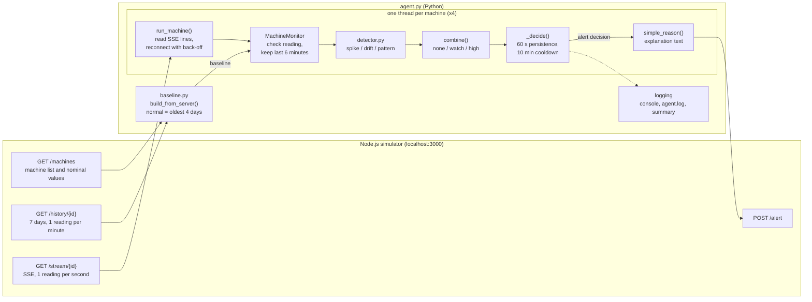

# Predictive Maintenance Agent

A Python agent that watches the live sensor streams of four simulated machines and raises an alert, with a plain-language explanation, when a machine shows warning signs. It:
- learns what "normal" looks like for each machine from its 7-day history;
- watches all four live streams at once;
- looks for three kinds of warning sign: sudden spikes, slow drifts, and several sensors misbehaving together.

The approach is statistical and rule-based on purpose. Every alert can be traced back to measured numbers and to a documented threshold. There is no trained model and no LLM.

**On the simulator:** CNC_02 (thermal runaway) and PUMP_03 (cavitation) are alerted about three minutes after the agent starts. The healthy CONVEYOR_04 stays silent, and so does CNC_01, whose slow bearing wear is too gradual to separate from noise within a few minutes. [Known limitations](#known-limitations) explains the CNC_01 case.

---

## How the requirements are met

| # | Requirement | Where it is done |
|---|---|---|
| 1 | Monitor the four machines concurrently through SSE | `agent.py`: one thread per machine (`run_agent`, `run_machine`, `read_stream_lines`) |
| 2 | Build normal-behaviour baselines from the 7-day history | `baseline.py` (`build_from_server`), rebuilt every time the agent starts |
| 3 | Detect spikes, gradual drift and unusual sensor patterns | `detector.py`: `detect_spikes`, `detect_drift`, `detect_patterns` |
| 4 | Confirm anomalies over consecutive evaluations before alerting | `agent.py`, `MachineMonitor._decide`: "high" risk must hold for 60 s, about 12 evaluations in a row |
| 5 | Alert cooldowns | 10 minutes per machine after an alert was sent |
| 6 | Send alerts to `POST /alert` | `agent.py`, `post_alert` |
| 7 | Human-readable explanations | `agent.py`, `simple_reason`: built from the measured evidence |
| 8 | Handle stream failures and reconnect | `agent.py`, `run_machine`: waits 1, 2, 4, 8, 15, then 30 s between attempts |
| 9 | Clear console logs and a summary | `agent.py`, `setup_logging` and `print_summary` |
| 10 | README and architecture diagram | this file ([Architecture](#architecture)) |

---

## Repository layout

| Path | What it is |
|---|---|
| `agent.py` | The agent: decision core, streaming and alerting, command line |
| `detector.py` | The three detectors. They produce evidence; they never decide or alert |
| `baseline.py` | Learns normal behaviour from history. Run as a script, it prints a report and writes `baseline.json` |
| `common.py` | Shared helpers: HTTP GET, timestamp parsing, reading validation |
| `explore.py` | First exploration of the simulator API; saves the 7-day history plots in `plots/` |
| `capture_live.py` | Records the four live streams to `data/live_<machine>.csv` |
| `try_detector.py` | Replays `data/*.csv` through the detectors and prints how often each one fires |
| `tests/` | Automated tests (standard `unittest`). `tests/fixtures/` holds frozen copies of the recordings and their baseline |
| `baseline.json` | Baseline from the same simulator run as the recordings in `data/` |
| `data/` | Six-minute live recordings of the four machines (2026-11-05, dashboard closed) |
| `plots/` | 7-day history plots made by `explore.py` |
| `requirements.txt` | Python packages |

Created when the agent runs, and ignored by git: `agent.log` and `agent_baseline.json`.

---

## Requirements

- **Python 3.** Developed and tested with Python 3.14.0 on Windows 11. The code only uses long-standing standard-library features, so Python 3.8 or newer should work, but no other version has been tested.
- **Node.js 16 or newer**, for the simulator.
- **Python packages** (`requirements.txt`):
  - `requests`: HTTP and the live streams; used by every script.
  - `matplotlib`: only `explore.py` needs it, for the plots.

  The agent and the tests need nothing else; the tests use the standard library's `unittest`.

---

## Setup

### 1. Start the simulator (a separate project)

```bash
git clone https://github.com/Jnanik-AI/malendau-hackathon.git
cd malendau-hackathon
npm install
npm start
```

The simulator serves http://localhost:3000; set the `PORT` environment variable to change it. Every start generates a new 7-day history, clears all alerts and resets the live machines.

> **Close the browser dashboard while the agent runs.** The simulator advances a machine by one step per second *for each connected client*. With the dashboard open, every machine runs twice as fast and its readings are split between the dashboard and the agent.

### 2. Install the agent

Windows (PowerShell):

```powershell
cd predictive-maintenance-agent
python -m venv venv
venv\Scripts\activate
pip install -r requirements.txt
```

macOS or Linux:

```bash
cd predictive-maintenance-agent
python3 -m venv venv
source venv/bin/activate
pip install -r requirements.txt
```

---

## Running the agent

Start with a dry run. It does everything except send alerts:

```
python agent.py --dry-run --duration 400
```

Then run it for real:

```
python agent.py
```

Stop with **Ctrl+C**. The agent closes its four streams, which takes a second or two, and prints a summary.

> Alerts cannot be deleted on the simulator; only a restart (`npm start`) clears them. Use `--dry-run` for rehearsals. To see the stored alerts: `curl.exe http://localhost:3000/alerts` in PowerShell, or `curl http://localhost:3000/alerts` elsewhere. They also appear in the dashboard's "Raised Alerts" panel.

### Options

| Option | Default | Meaning |
|---|---|---|
| `--base-url URL` | `http://localhost:3000` | Simulator address |
| `--dry-run` | off | Decide and log, but never POST an alert |
| `--duration SECONDS` | run until Ctrl+C | Stop by itself after this many seconds |
| `--log-file FILE` | `agent.log` | Full log, including every evidence item as JSON; appended to, not replaced |
| `--save-baseline FILE` | `agent_baseline.json` | Where the baseline rebuilt at startup is saved |
| `--use-saved-baseline FILE` | not set | Skip the rebuild and use this baseline file |

The agent never writes `baseline.json`. That file belongs to `baseline.py` and matches the recordings in `data/`.

### Examples

```
python agent.py --dry-run --duration 300                             # 5-minute rehearsal, nothing is posted
python agent.py --base-url http://localhost:3001                     # simulator started with PORT=3001
python agent.py --dry-run --use-saved-baseline agent_baseline.json   # reuse the baseline from the last start
python agent.py --duration 600 --log-file demo.log                   # 10-minute live run with its own log file
```

A saved baseline describes the history of the simulator run it was built from. The simulator makes a new history on every restart. The statistics are very similar from run to run, but a rebuild (the default) is the safe choice.

### What the console shows

The excerpt below is real output from a dry run against the test simulator (`tests/fake_simulator.py`), which replays the recorded data:

```
INFO    machine=CNC_01 level=none risk=0.0 decision=none (level none) evidence=[-]
INFO    machine=CONVEYOR_04 level=watch risk=1.1 decision=none (level watch) evidence=[spike:vibration_mm_s=1.1]
INFO    machine=PUMP_03 level=high risk=6.0 decision=waiting (high for 51 s of 60 s required) evidence=[spike:vibration_mm_s=2.0 pattern:vibration_variability=3.1 pattern:co_elevation=4.0]
WARNING machine=PUMP_03 DRY RUN, would alert: PUMP_03: sustained abnormal behaviour (risk score 5.6). vibration_mm_s and current_A were abnormal at the same time in 71% of the last 120 s. vibration is 14.7x more variable than normal (std 2.20 mm/s over 120 s). vibration_mm_s was abnormal in 100% of the last 60 s (latest 3.2 mm/s vs normal 2.2). Inspection recommended.
...
INFO    Summary (DRY RUN: 'alerts' are alerts that would have been sent):
INFO      CNC_01       readings=493 evaluations=99 alerts=0 malformed=0 out_of_order=0 gaps=0 reconnects=0 stream_errors=0 unexpected_errors=0
INFO      CNC_02       readings=493 evaluations=99 alerts=1 malformed=0 out_of_order=0 gaps=0 reconnects=0 stream_errors=0 unexpected_errors=0
INFO      PUMP_03      readings=493 evaluations=99 alerts=1 malformed=0 out_of_order=0 gaps=0 reconnects=0 stream_errors=0 unexpected_errors=0
INFO      CONVEYOR_04  readings=493 evaluations=99 alerts=0 malformed=0 out_of_order=0 gaps=0 reconnects=0 stream_errors=0 unexpected_errors=0
```

How to read an evaluation line, written about every 5 s per machine:
- **`level`**: `none` (no evidence), `watch` (evidence, but not corroborated) or `high` (corroborated; see [Detection approach](#detection-approach)).
- **`risk`**: the strongest score of each detector kind, added up. A score is measured against that detector's own threshold: 1.0 means exactly at the threshold.
- **`decision`**:
  - `none`
  - `waiting`: "high", but not for long enough yet
  - `alert`
  - `cooldown`: "high", but an alert was sent less than 10 minutes ago
- **`evidence`**: `detector:name=score` for every active piece of evidence. For spike evidence the score is the share of the last 60 s spent above the spike line, divided by 50%, so `2.0` means all of the last 60 s.

The log file (`agent.log`) also gets a DEBUG line for each active evidence item, with all its numbers as JSON.

### The other scripts

| Command | What it does | Writes |
|---|---|---|
| `python explore.py` | Prints the API responses and data checks, reads a few live readings, plots the history | `plots/<machine>_history.png` |
| `python explore.py --test-posts` | Also tests the POST endpoints: **stores one labelled test alert** | nothing locally |
| `python capture_live.py --seconds 360` | Records all four live streams at the same time | `data/live_<machine>.csv` (overwrites) |
| `python baseline.py` | Builds the baseline and prints a report: daily means, drift check, first day each sensor departs from normal | `baseline.json` (overwrites; `--out FILE` writes elsewhere) |
| `python try_detector.py` | Replays `data/*.csv` through the detectors | nothing |

---

## Architecture



**Two programs, one HTTP connection per job.** The simulator is a separate Node.js server, and the agent talks to it only over HTTP.
- **At startup:** the agent downloads `/machines` and the 7-day `/history` of each machine, and builds the baseline in memory.
- **While running:** it opens one Server-Sent Events stream per machine. That is a never-ending HTTP response in which the server writes a `data: {json}` line every second.
- **On an alert:** it sends `POST /alert`.

**One thread per machine, nothing shared.**
- Each thread owns its `MachineMonitor`, so there is no shared data to lock.
- The threads share only a "please stop" flag (`threading.Event`) and the logger.
- The main thread sleeps in short naps and watches for Ctrl+C or the `--duration` deadline. When it sees either, it sets the stop flag and waits up to 15 s for the threads.

**Decision core and I/O are kept apart.** `MachineMonitor` has no network code. It measures time by the readings' timestamps, not by the wall clock. That is why the tests can replay recorded data through the exact decision logic at full speed and get the same answers.

**Failure handling.**
- **A stream that breaks**: refused, broken, or silent for 10 s. It is reopened after 1, 2, 4, 8, 15 s, then every 30 s, and the wait goes back to 1 s as soon as data flows again.
- **A bad reading**: missing field, not a number, wrong machine, timestamp older than the last one. It is counted and logged, never used.
- **A bug or a surprising answer**: caught by a last-resort handler that logs the full traceback and reconnects. One machine's problem cannot stop the others.

---

## Detection approach

### 1. Learning "normal" from the history (`baseline.py`)

The agent downloads all 7 days: 10,081 readings per machine, one per minute. That history is **not** a clean normal week, because the simulator builds the faults into its later days. Daily means from the real history (`baseline.json`) show it:

| Sensor | Day 1 | Day 2 | Day 3 | Day 4 | Day 5 | Day 6 | Day 7 |
|---|---|---|---|---|---|---|---|
| CNC_01 vibration (mm/s) | 1.80 | 1.80 | 1.80 | 1.80 | **2.97** | **4.13** | **5.30** |
| CNC_02 temperature (°C) | 67.9 | 68.1 | 68.0 | 68.0 | 68.0 | **74.9** | **73.6** |
| PUMP_03 rpm | **2925** | **2900** | **2873** | **2846** | **2823** | **2795** | **2770** |

What `baseline.py` does about this:
- **Normal is learned from the oldest 4 days only** (`REFERENCE_DAYS`). The first sensor to leave its normal level does so on day 5. Learning from the whole week would treat CNC_01's worn bearing as normal.
- **Robust statistics.** Median and MAD-based spread are stored next to mean and standard deviation, so a one-off event inside those 4 days cannot move "normal". An example is CONVEYOR_04's 72-minute vibration excursion on day 3.
- **Statistics per sensor, overall and for each UTC hour of the day.** The task asks for the hourly ones. In this data they are almost flat: the largest hour-to-hour difference is 0.46 spreads.
- **Sensors that are already drifting.** PUMP_03's rpm falls from day 1, so its history has no healthy level. `baseline.py` detects this (daily medians move by 2.5 spreads) and uses the nominal value from `/machines`, 2950 rpm, as normal instead.
- **No zero spreads.** A spread can never be zero: it is floored at 0.1% of the nominal value, so later divisions are safe.

### 2. Live noise is not history noise

The live stream is noisier and smoother than the per-minute history. Compare live readings with the history spread alone, using the same thresholds the detectors use, and 58% of the healthy CONVEYOR_04's readings and 25% of the near-healthy CNC_01's look abnormal (measured on the recordings).

So every comparison uses an **effective spread**: the larger of the history spread and the typical live noise of that sensor. The live noise values are 1.2 °C, 0.15 mm/s, 23 rpm and 0.45 A. They are the same for every machine, because the simulator adds the same noise to all of them, and they agree with its noise model. With the effective spread, CNC_01 has no spikes at all. CONVEYOR_04's random vibration bursts still cross the spike line in 22% of its readings, which is why one detector alone is never enough to alert.

### 3. The three detectors (`detector.py`)

Each detector returns evidence with a score, where 1.0 means exactly at its threshold, plus the real numbers for the explanation. The two window detectors return nothing at all ("not evaluated", never "all clear") until their window is at least 90% full and holds at least 30 readings.

| Detector | Looks at | Fires when | Typical cause |
|---|---|---|---|
| **Spike** | each reading | the value is more than 4 spreads (vibration: 5) from normal in the suspicious direction: high for temperature, vibration and current; either way for rpm. It counts as evidence only if it holds for at least 50% of the last 60 s | overheating, current surges, cavitation bursts |
| **Drift** | newest 300 s | a straight line fitted against time changes by at least 5 spreads in the suspicious direction (rpm: falling), **and** each half of the window carries at least 25% of that change, so a sudden jump does not count as drift | gradual wear |
| **Pattern: vibration variability** | newest 120 s | the standard deviation of vibration is at least 5 times its normal spread | bursty, unstable vibration |
| **Pattern: co-elevation** | newest 120 s | in at least 20% of the readings, at least two of temperature (≥ 3 spreads), vibration (≥ 3) and current (≥ 2) are high **at the same moment** | coupled faults: pump cavitation (vibration + current), CNC_02's heat (temperature + current) |
| **Pattern: rpm decline with current change** | newest 120 s | mean rpm at least 3 spreads low **and** mean current at least 2 spreads off normal, in either direction | clog or load change |

A standard significance test on the trend slope is deliberately not used. Live readings are strongly correlated from one second to the next, and in a simulation during development such a test called 70% of pure-noise windows a "trend". A large change that shows up in both halves of the window is much more reliable here.

### 4. From evidence to an alert (`agent.py`)

1. Every 5 s of data, for each machine, the detectors run on the last 6 minutes of readings.
2. **Risk level.** `high` needs **at least two kinds of detector AND at least two different sensors**. Anything less is `watch`; no evidence is `none`. One noisy sensor, or one detector, can therefore never reach `high`.
3. **Confirmation.** `high` must hold for **60 s**, about 12 evaluations in a row, before an alert is sent:
   - One isolated evaluation below `high` is tolerated; two in a row restart the clock.
   - A gap of more than 15 s in the data also restarts it: evidence must be re-established after an outage.
4. **Alert.** The explanation is built and `POST /alert` is sent. After a successful POST the machine gets a **10-minute cooldown**. If the POST fails, no cooldown starts and the agent tries again at the next evaluation, about 5 s later.

**Why the healthy conveyor stays quiet.** Its random bursts trigger the vibration spike for up to 56 s in a row, and sometimes the variability pattern. Both are about vibration only, so the level stays at `watch`. The 60 s confirmation is also just longer than the longest burst.

**What happens on the recorded data.** These results come from replaying the recordings through `MachineMonitor`, and the test suite checks them:

| Machine | Simulated fault | What the agent sees | Outcome |
|---|---|---|---|
| CNC_01 | slow bearing wear | occasional drift on vibration only | `watch` 3 times, no alert |
| CNC_02 | thermal spike every ~3 minutes | temperature spike + temperature/current co-elevation | alert 173 s after the first reading |
| PUMP_03 | random cavitation bursts | vibration spike + vibration variability + vibration/current co-elevation | alert 172 s after the first reading |
| CONVEYOR_04 | healthy, rare vibration bursts | vibration spike only | `watch` 12 times, no alert |

The first alert can come about 170 s after the start at the earliest: the 2-minute pattern window needs 108 s of data, then 60 s of confirmation.

---

## Alert behaviour

- **What is sent:** `POST /alert` with `{"machine_id", "reason", "reading"}`, where `reading` is the newest reading. The simulator answers `201` and stores the alert.
- **The reason** is built only from the measured evidence, strongest first. It never claims a failure is certain. For example:

  > CNC_02: sustained abnormal behaviour (risk score 5.2). temperature_C and current_A were abnormal at the same time in 80% of the last 120 s. temperature_C was abnormal in 59% of the last 60 s (latest 87.2 C vs normal 68.0). Inspection recommended.

- **Dry run** (`--dry-run`): the same decisions, logged as `DRY RUN, would alert: ...`. Nothing is posted, and the cooldown still applies, so the log shows the real rhythm of alerts.
- **When posting fails** (no answer, timeout, any status other than 201), the error is logged and the alert is retried at the next evaluation. A `201` with an unexpected body still counts as sent, because 201 means the server stored it, and sending it again would create a duplicate.
- **Repeat alerts:** while a fault continues, the machine is alerted again when its 10-minute cooldown ends. If the fault went away, a new episode needs its own 60 s of confirmation.
- **Maintenance booking** (`POST /schedule-maintenance`, an optional bonus) is **not implemented**. Bookings on the simulator can be neither listed nor deleted, and the required alerting was the priority.

---

## Configuration and thresholds

Every setting is a named constant at the top of the file that uses it, with a comment giving the reason or measurement behind its value. To change behaviour, edit the constant; no threshold is buried inside the logic.

**`agent.py`: decisions, timing, connections**

| Constant | Value | Meaning |
|---|---|---|
| `EVAL_INTERVAL_S` | 5 s | How often the detectors run per machine (data time) |
| `WINDOW_KEEP_S` | 360 s | Readings kept per machine: the 300 s drift window plus margin |
| `SPIKE_LOOKBACK_S`, `SPIKE_SUSTAINED_SHARE`, `SPIKE_MIN_READINGS` | 60 s, 50%, 20 | A spike becomes evidence when present in at least half of the last 60 s |
| `PERSISTENCE_S` | 60 s | How long `high` must hold; just above the conveyor's longest burst (56 s) |
| `PERSISTENCE_RESET_EVALS` | 2 | Evaluations in a row below `high` that restart the clock |
| `COOLDOWN_S` | 600 s | Silence per machine after an alert (CNC_02 re-heats every ~3 minutes) |
| `MAX_GAP_S` | 15 s | A longer silence in the data restarts the confirmation |
| `RECONNECT_DELAYS_S` | 1, 2, 4, 8, 15, 30 s | Waits between reconnection attempts; the last one repeats |
| `STREAM_CONNECT_TIMEOUT_S`, `STREAM_READ_TIMEOUT_S` | 5 s, 10 s | A stream silent for 10 s is treated as dead (readings come every second) |
| `POST_TIMEOUT_S` | 10 s | Time limit for `POST /alert` |
| `SHUTDOWN_WAIT_S` | 15 s | How long the agent waits for its threads when stopping |

**`detector.py`: detection thresholds (in effective spreads unless stated)**

| Constant | Value | Meaning and evidence |
|---|---|---|
| `LIVE_NOISE_SD` | 1.2 °C, 0.15 mm/s, 23 rpm, 0.45 A | Typical live noise; the smallest spread ever used |
| `SPIKE_THRESHOLD_Z` | temperature 4, vibration 5, rpm 4, current 4 | Above the largest deviation on the near-healthy CNC_01 recording (1.4 to 3.5 spreads) |
| `SPIKE_DIRECTION` | high, high, both, high | Which direction is suspicious |
| `DRIFT_WINDOW_S` | 300 s | Length of the trend window |
| `DRIFT_MIN_CHANGE_SPREADS` | 5 | In a simulation of live-like noise: about 0.3 false trends per sensor per day; ramps of 8 spreads caught in 81% of windows |
| `DRIFT_HALF_SHARE` | 25% | Share of the change each half of the window must carry (rejects jumps) |
| `DRIFT_MIN_POINTS`, `DRIFT_MIN_COVERAGE` | 30, 90% | Minimum data before a trend is judged |
| `PATTERN_WINDOW_S` | 120 s | Length of the pattern window |
| `PATTERN_VIB_STD_RATIO` | 5 | Measured ratio: CONVEYOR_04 at most 3.9, PUMP_03 4.4 to 21.8 |
| `PATTERN_MOMENT_Z` | temperature 3, vibration 3, current 2 | "Abnormal at this moment" levels for co-elevation |
| `PATTERN_CO_ELEVATION_SHARE` | 20% | The healthy machines stayed far below; the pump never fell below it |
| `PATTERN_RPM_LOW_Z`, `PATTERN_CURRENT_CHANGE_Z` | 3, 2 | Judgement values: this pattern never occurs in the live data |

**`baseline.py`: learning normal**

| Constant | Value | Meaning |
|---|---|---|
| `REFERENCE_DAYS` | 4 | Oldest days used as "normal" (faults start on day 5) |
| `MIN_SAMPLES` | 30 | Fewest readings a statistic is computed from |
| `MIN_STD_FRACTION` | 0.1% of nominal | Floor for every spread (`ABSOLUTE_MIN_STD` = 1e-6 if the nominal value is 0) |
| `DRIFT_RATIO_LIMIT` | 1.0 | Daily medians moving more than 1 spread inside the window = already drifting |
| `DEPARTURE_SPREADS` | 3 | A day whose mean is this far off counts as "departed" in the report |
| `TAIL_DISAGREEMENT` | 0.5 | Mean-versus-median gap that flags outlier-heavy hours in the report |

`common.py` holds the default simulator address (`DEFAULT_BASE_URL`) and the HTTP timeout for normal requests (`REQUEST_TIMEOUT`, 10 s).

---

## Testing

```
python -m unittest discover -v
```

Run it from the project folder. It runs 86 tests in about 25 seconds and needs **no simulator**. The two end-to-end tests start a small fake simulator on 127.0.0.1 that replays the recordings about 40 times faster than real time. Every test of alert sending uses fakes or that local fake server, so no test ever posts to the real simulator.

| File | What it checks |
|---|---|
| `tests/test_common.py` | Timestamp parsing (UTC, offsets, missing time zone), reading validation, HTTP error messages |
| `tests/test_baseline.py` | Baselines from synthetic 7-day histories: late faults stay out of "normal", drifting sensors fall back to nominal, spread floors, rounding |
| `tests/test_detector.py` | Each detector on data with known answers: thresholds and directions, history vs live-noise spread, hourly fallback, gradual ramps vs sudden steps, uneven timestamps, each pattern firing and not firing |
| `tests/test_agent_decisions.py` | Evidence combination (`watch` vs `high`), 60 s confirmation, dip tolerance, cooldown, retry after a failed POST, bad input, data gaps. Also the recorded captures (CNC_02 and PUMP_03 alert at 173 s and 172 s; CNC_01 and CONVEYOR_04 never), and 20-minute healthy streams with conveyor-like bursts that never alert |
| `tests/test_agent_io.py` | `post_alert` success and failures, dry run never posts, cooldown only after success, SSE line parsing, reconnect waits 1, 2, 4, 8, 15, 30 s, unexpected errors survived, startup options (the default never touches `baseline.json`) |
| `tests/test_end_to_end.py` | The real `run_agent()` with four threads against the fake simulator: one alert each for CNC_02 and PUMP_03 even though every stream breaks once; dry run sends nothing |

`python try_detector.py` replays the recordings in `data/` through the detectors and prints how often each one fires.

**Manual checks on the real simulator:**
- A 400-second dry run detected CNC_02 and PUMP_03.
- A Ctrl+C test stopped all four monitoring threads cleanly.
- During development the agent also ran against a fake simulator in 11 failure scenarios: dropped and refused streams, HTTP 503 and 500 answers, malformed data, unexpected replies, no server, Ctrl+C. The test suite keeps the essential checks from those runs.

---

## Known limitations

- **CNC_01's bearing wear is too slow to see live within minutes.** In the history it rises in daily steps. In the live stream the simulator's wear term levels off at about +0.2 mm/s, which is below the live noise. A single drift signal on one sensor can only reach `watch`, so CNC_01 is not expected to alert in a short run. This is a deliberate trade-off against false alarms.
- **The thresholds are tuned to this simulator.** The live noise values and several thresholds were chosen from six-minute recordings and from the simulator's noise model. The recorded-data results above come partly from the same recordings, so they are partly in-sample. A real deployment would calibrate the noise levels on its own healthy machines.
- **One pattern was never seen live.** The "rpm decline with current change" pattern never occurs in the live data, so its thresholds are judgement values tested only on synthetic data.
- **The variability margin is thin.** The healthy conveyor reaches a variability ratio of 3.9 against a threshold of 5.
- **The cooldown is fixed.** It is 10 minutes, with no escalation if a fault gets worse during it.
- **The first alert takes about 3 minutes.** The windows have to fill (about 108 s), then the 60 s confirmation runs.
- **The hour-of-day baselines barely matter here.** They are computed because the task asks for them, but this simulator has no real daily cycle in its normal data.
- **Simulator behaviour the agent cannot control:**
  - Extra stream clients, such as an open dashboard, speed machines up.
  - A simulator restart while the agent runs is not detected: the agent reconnects but keeps its baseline. The statistics are very similar between runs.
  - Alerts can only be cleared by restarting the simulator.
- **The `status` field is ignored on purpose.** It is the simulator's own label; detection uses the sensor values only.
- **No log rotation.** `agent.log` keeps growing, by roughly 2 to 3 MB per hour of running (measured: 312 KB for about 8 minutes of data with two machines alerting).
- **Only one environment tested.** Python 3.14.0 on Windows 11.
- **No maintenance booking.** The optional `/schedule-maintenance` call is not implemented.

## Possible improvements

- A history-replay mode that feeds the 7-day history through the same pipeline, to show that CNC_01's wear is caught days before the simulator marks it as a fault.
- Longer trend windows, for example hours, for slow wear, alongside the 5-minute one.
- Severity escalation during a cooldown when the risk keeps rising.
- Maintenance booking after an alert, with protection against double bookings.
- Calibrating live noise from a commissioning period instead of fixed constants.
- An optional Isolation Forest as an extra, low-weight evidence kind. It would never decide alone.
- A configuration file and log rotation for long-running use.
