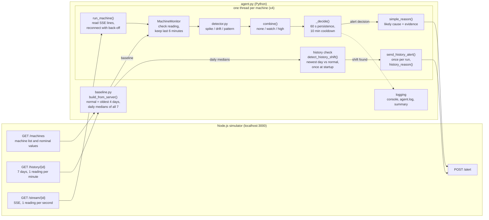

# Predictive Maintenance Agent

A Python agent that watches the live sensor streams of four simulated machines and raises an alert, with a plain-language explanation, when a machine shows warning signs. It:
- learns what "normal" looks like for each machine from its 7-day history;
- checks that same history for slow, multi-day degradation: a machine whose typical level has moved away from normal;
- watches all four live streams at once, looking for three kinds of warning sign: sudden spikes, slow drifts, and several sensors misbehaving together;
- names a likely cause in every alert, with the measured numbers behind it and a suggested check.

The approach is statistical and rule-based on purpose. Every alert can be traced back to measured numbers and to a documented threshold. There is no trained model and no LLM.

**On the simulator** (230-second dry run against the real simulator, 2026-11-07):

| Machine | Simulated fault | What the agent raises |
|---|---|---|
| CNC_01 | bearing wear | a **history** alert at startup: vibration 1.80 → 5.30 mm/s over days 4–7, with temperature and current also up; likely cause bearing wear |
| CNC_02 | thermal runaway | a **live** alert after 173 s: temperature and motor current high together; likely cause overheating under load |
| PUMP_03 | cavitation and a developing clog | a **history** alert at startup for the clog (speed 2950 → 2770 rpm, about −26 rpm per day), and a **live** alert after 178 s for the cavitation |
| CONVEYOR_04 | none (healthy baseline) | nothing: no history shift, and risk level `none` on all 46 live evaluations |

CNC_01's wear and PUMP_03's clog are visible only in the history, because the simulator's live stream restarts every machine near its nominal values. [Known limitations](#known-limitations) explains what that means.

---

## What the assignment asks for, and where it is done

The assignment (Jnanik AI intern evaluation, "Predictive Maintenance Agent") asks for an agent that monitors the live sensor data, spots warning signs and raises an alert **before** a machine fails.

| Assignment item | Where it is done | Status |
|---|---|---|
| 1. Ingest live sensor data: connect to the simulation API and read readings in real time | `agent.py`: one thread and one SSE stream per machine (`run_agent`, `run_machine`, `read_stream_lines`) | Done |
| 2. Detect anomalies: "a spike, a slow drift, or an unusual pattern" | Live: `detector.py` `detect_spikes`, `detect_drift`, `detect_patterns`. Slow, multi-day drift: `detect_history_shift` on the 7-day history | Done; see [limitations](#known-limitations) |
| 3. Raise an alert: call `POST /alert` with a reason | `agent.py`: `post_alert`, called by `handle_result` (live) and `send_history_alert` (history) | Done |
| 4. Explain the decision: a short, human-readable explanation of what triggered the alert | `agent.py`: `simple_reason` (live) and `history_reason` (history): likely cause, measured evidence, suggested check | Done |
| API table: use `GET /history` "to learn what normal looks like" | `baseline.py` (`build_from_server`), rebuilt every time the agent starts | Done |
| Bonus: call `POST /schedule-maintenance` after an alert | | **Not implemented** |
| Submit: GitHub repository with a README that explains how to run it | this file | Done |
| Submit: one architecture diagram | [Architecture](#architecture) | Done |
| Submit: live walkthrough (no recording) | | At the presentation |

**Our own design choices, not asked for by the assignment:** two kinds of evidence on two sensors before a live alert, a 60 s confirmation, a 10-minute cooldown, reconnection with back-off, hour-of-day statistics, the dry-run mode, the summary counters and the automated tests. Each is explained below.

---

## Repository layout

| Path | What it is |
|---|---|
| `agent.py` | The agent: decision core, streaming and alerting, command line |
| `detector.py` | The three live detectors and the history check. They produce evidence; they never decide or alert |
| `baseline.py` | Learns normal behaviour from history. Run as a script, it prints a report and writes `baseline.json` |
| `common.py` | Shared helpers: HTTP GET, timestamp parsing, reading validation |
| `explore.py` | First exploration of the simulator API; saves the 7-day history plots in `plots/` |
| `capture_live.py` | Records the four live streams to `data/live_<machine>.csv` |
| `try_detector.py` | Replays `data/*.csv` through the detectors and prints how often each one fires |
| `tests/` | Automated tests (standard `unittest`). `tests/fixtures/` holds frozen copies of the recordings and their baseline; `tests/sim_history.py` makes 7-day histories with the simulator's own formulas |
| `baseline.json` | Baseline from the same simulator run as the recordings in `data/`. It was made before the history check existed, so it has no daily medians |
| `data/` | Six-minute live recordings of the four machines (2026-11-05, dashboard closed) |
| `plots/` | 7-day history plots made by `explore.py` |
| `requirements.txt` | Python packages |

Created when the agent runs, and ignored by git: `agent.log` and `agent_baseline.json`.

---

## Requirements

- **Python 3.** Developed and tested with Python 3.14.0 on Windows 11. The code only uses long-standing standard-library features, so Python 3.8 or newer should work, but no other version has been tested.
- **Node.js 16 or newer**, for the simulator.
- **Python packages** (`requirements.txt`):
  - `requests`: HTTP and the live streams; used by every script.
  - `matplotlib`: only `explore.py` needs it, for the plots.

  The agent and the tests need nothing else; the tests use the standard library's `unittest`.

---

## Setup

### 1. Start the simulator (a separate project)

```bash
git clone https://github.com/Jnanik-AI/malendau-hackathon.git
cd malendau-hackathon
npm install
npm start
```

The simulator serves http://localhost:3000; set the `PORT` environment variable to change it. Every start generates a new 7-day history, clears all alerts and resets the live machines.

> **Close the browser dashboard while the agent runs.** The simulator advances a machine by one step per second *for each connected client*. With the dashboard open, every machine runs twice as fast and its readings are split between the dashboard and the agent.

### 2. Install the agent

Windows (PowerShell):

```powershell
cd predictive-maintenance-agent
python -m venv venv
venv\Scripts\activate
pip install -r requirements.txt
```

macOS or Linux:

```bash
cd predictive-maintenance-agent
python3 -m venv venv
source venv/bin/activate
pip install -r requirements.txt
```

---

## Running the agent

Start with a dry run. It does everything except send alerts:

```
python agent.py --dry-run --duration 400
```

Then run it for real:

```
python agent.py
```

Stop with **Ctrl+C**. The agent closes its four streams, which takes a second or two, and prints a summary.

> Alerts cannot be deleted on the simulator; only a restart (`npm start`) clears them. Use `--dry-run` for rehearsals. To see the stored alerts: `curl.exe http://localhost:3000/alerts` in PowerShell, or `curl http://localhost:3000/alerts` elsewhere. They also appear in the dashboard's "Raised Alerts" panel.

### Options

| Option | Default | Meaning |
|---|---|---|
| `--base-url URL` | `http://localhost:3000` | Simulator address |
| `--dry-run` | off | Decide and log, but never POST an alert |
| `--duration SECONDS` | run until Ctrl+C | Stop by itself after this many seconds |
| `--log-file FILE` | `agent.log` | Full log, including every evidence item as JSON; appended to, not replaced |
| `--save-baseline FILE` | `agent_baseline.json` | Where the baseline rebuilt at startup is saved |
| `--use-saved-baseline FILE` | not set | Skip the rebuild and use this baseline file. A file without daily medians (such as `baseline.json`) skips the history check, and the log says so |

The agent never writes `baseline.json`. That file belongs to `baseline.py` and matches the recordings in `data/`.

### Examples

```
python agent.py --dry-run --duration 300                             # 5-minute rehearsal, nothing is posted
python agent.py --base-url http://localhost:3001                     # simulator started with PORT=3001
python agent.py --dry-run --use-saved-baseline agent_baseline.json   # reuse the baseline from the last start
python agent.py --duration 600 --log-file demo.log                   # 10-minute live run with its own log file
```

A saved baseline describes the history of the simulator run it was built from. The simulator makes a new history on every restart. The statistics are very similar from run to run, but a rebuild (the default) is the safe choice.

### What the console shows

The excerpt below is real output from a 230-second dry run against the real simulator on 2026-11-07 (timestamps removed, `...` marks skipped lines):

```
INFO    loaded 10081 readings for CNC_01
...
WARNING machine=CNC_01 history check: SHIFT found: temperature_C +7.5 spreads (day 7 median 83.98 vs normal 72.06); vibration_mm_s +78.7 spreads (day 7 median 5.3 vs normal 1.8); current_A +8.8 spreads (day 7 median 14.99 vs normal 12.51)
INFO    machine=CNC_02 history check: no sustained shift (largest: current_A +0.5 spreads; alert at 3.0)
WARNING machine=PUMP_03 history check: SHIFT found: rpm +5.4 spreads (day 7 median 2770.5 vs normal 2950)
INFO    machine=CONVEYOR_04 history check: no sustained shift (largest: vibration_mm_s +0.0 spreads; alert at 3.0)
WARNING machine=CNC_01 DRY RUN, would alert (history): CNC_01: warning from the 7-day history. Likely cause: bearing wear. Evidence (daily medians): vibration 5.30 mm/s vs normal 1.80 (+194%), day 4 to 7: 1.80 -> 2.97 -> 4.13 -> 5.30 (about +1.17 mm/s per day), above normal since day 5; motor current 15.0 A vs normal 12.5 (+20%); temperature 84.0 C vs normal 72.1 (+17%). Suggested check: bearing condition and lubrication.
WARNING machine=PUMP_03 DRY RUN, would alert (history): PUMP_03: warning from the 7-day history. Likely cause: a growing restriction or load slowing the machine, such as a developing clog. Evidence (daily medians): speed 2770 rpm vs nominal 2950 (-6%), day 1 to 7: 2923 -> 2899 -> 2873 -> 2848 -> 2821 -> 2796 -> 2770 (about -26 rpm per day), below normal since day 4. Suggested check: blockage at the inlet, filter or impeller, or a dragging drive.
INFO    monitoring 4 machines: CNC_01, CNC_02, PUMP_03, CONVEYOR_04
...
INFO    machine=CONVEYOR_04 level=none risk=0.0 decision=none (level none) evidence=[-]
INFO    machine=CNC_02 level=high risk=7.0 decision=waiting (high for 55 s of 60 s required) evidence=[spike:temperature_C=2.0 spike:current_A=1.1 pattern:co_elevation=5.0]
WARNING machine=CNC_02 DRY RUN, would alert: CNC_02: abnormal behaviour in the live stream. Likely cause: overheating under load (thermal runaway). Evidence: temperature and motor current high at the same moment in 100% of the last 119 s; temperature above its normal range in 100% of the last 60 s (latest 74.1 C, normal 67.9). Suggested check: cooling (coolant flow, fans) and machine load.
...
INFO    Summary (DRY RUN: 'alerts' are alerts that would have been sent):
INFO      CNC_01       readings=227 evaluations=46 alerts=0 history_alerts=1 malformed=0 out_of_order=0 gaps=0 reconnects=0 stream_errors=0 unexpected_errors=0
INFO      CNC_02       readings=227 evaluations=46 alerts=1 history_alerts=0 malformed=0 out_of_order=0 gaps=0 reconnects=0 stream_errors=0 unexpected_errors=0
INFO      PUMP_03      readings=227 evaluations=46 alerts=1 history_alerts=1 malformed=0 out_of_order=0 gaps=0 reconnects=0 stream_errors=0 unexpected_errors=0
INFO      CONVEYOR_04  readings=227 evaluations=46 alerts=0 history_alerts=0 malformed=0 out_of_order=0 gaps=0 reconnects=0 stream_errors=0 unexpected_errors=0
```

At startup, each machine gets one **history check** line:
- `SHIFT found`: each shifted sensor, its shift in spreads, and the newest day's median against normal;
- `no sustained shift`: the largest shift seen;
- `not evaluated`: the baseline file has no daily medians.

How to read an evaluation line, written about every 5 s per machine:
- **`level`**: `none` (no evidence), `watch` (evidence, but not corroborated) or `high` (corroborated; see [Detection approach](#detection-approach)).
- **`risk`**: the strongest score of each detector kind, added up. A score is measured against that detector's own threshold: 1.0 means exactly at the threshold.
- **`decision`**:
  - `none`
  - `waiting`: "high", but not for long enough yet
  - `alert`
  - `cooldown`: "high", but an alert was sent less than 10 minutes ago
- **`evidence`**: `detector:name=score` for every active piece of evidence. For spike evidence the score is the share of the last 60 s spent above the spike line, divided by 50%, so `2.0` means all of the last 60 s.

The log file (`agent.log`) also gets a DEBUG line for each active evidence item, with all its numbers as JSON.

### The other scripts

| Command | What it does | Writes |
|---|---|---|
| `python explore.py` | Prints the API responses and data checks, reads a few live readings, plots the history | `plots/<machine>_history.png` |
| `python explore.py --test-posts` | Also tests the POST endpoints: **stores one labelled test alert** | nothing locally |
| `python capture_live.py --seconds 360` | Records all four live streams at the same time | `data/live_<machine>.csv` (overwrites) |
| `python baseline.py` | Builds the baseline and prints a report: daily means, drift check, first day each sensor departs from normal | `baseline.json` (overwrites; `--out FILE` writes elsewhere) |
| `python try_detector.py` | Replays `data/*.csv` through the detectors | nothing |

---

## Architecture



**Two programs, one HTTP connection per job.** The simulator is a separate Node.js server, and the agent talks to it only over HTTP.
- **At startup:** the agent downloads `/machines` and the 7-day `/history` of each machine, builds the baseline in memory and runs the history check. A machine whose history has shifted gets one alert straight away, before its stream opens.
- **While running:** it opens one Server-Sent Events stream per machine. That is a never-ending HTTP response in which the server writes a `data: {json}` line every second.
- **On an alert:** it sends `POST /alert`.

**One thread per machine, nothing shared.**
- Each thread owns its `MachineMonitor`, so there is no shared data to lock.
- The threads share only a "please stop" flag (`threading.Event`) and the logger.
- The main thread sleeps in short naps and watches for Ctrl+C or the `--duration` deadline. When it sees either, it sets the stop flag and waits up to 15 s for the threads.

**Decision core and I/O are kept apart.** `MachineMonitor` has no network code. It measures time by the readings' timestamps, not by the wall clock. That is why the tests can replay recorded data through the exact decision logic at full speed and get the same answers.

**Failure handling.**
- **A stream that breaks**: refused, broken, or silent for 10 s. It is reopened after 1, 2, 4, 8, 15 s, then every 30 s, and the wait goes back to 1 s as soon as data flows again.
- **A bad reading**: missing field, not a number, wrong machine, timestamp older than the last one. It is counted and logged, never used.
- **A bug or a surprising answer**: caught by a last-resort handler that logs the full traceback and reconnects. One machine's problem cannot stop the others.

---

## Detection approach

### 1. Learning "normal" from the history (`baseline.py`)

The agent downloads all 7 days: 10,081 readings per machine, one per minute. That history is **not** a clean normal week, because the simulator builds the faults into its later days. Daily means from the real history (`baseline.json`) show it:

| Sensor | Day 1 | Day 2 | Day 3 | Day 4 | Day 5 | Day 6 | Day 7 |
|---|---|---|---|---|---|---|---|
| CNC_01 vibration (mm/s) | 1.80 | 1.80 | 1.80 | 1.80 | **2.97** | **4.13** | **5.30** |
| CNC_02 temperature (°C) | 67.9 | 68.1 | 68.0 | 68.0 | 68.0 | **74.9** | **73.6** |
| PUMP_03 rpm | **2925** | **2900** | **2873** | **2846** | **2823** | **2795** | **2770** |

What `baseline.py` does about this:
- **Normal is learned from the oldest 4 days only** (`REFERENCE_DAYS`). The first sensor to leave its normal level does so on day 5. Learning from the whole week would treat CNC_01's worn bearing as normal.
- **Robust statistics.** Median and MAD-based spread are stored next to mean and standard deviation, so a one-off event inside those 4 days cannot move "normal". An example is CONVEYOR_04's 72-minute vibration excursion on day 3.
- **Statistics per sensor, overall and for each UTC hour of the day.** The assignment does not ask for hourly statistics; they were added because CNC_02's fault is described as an afternoon problem. In this data they are almost flat: the largest hour-to-hour difference is 0.46 spreads.
- **The median of every day of the history**, for the history check ([section 5](#5-the-history-check-detectordetect_history_shift)).
- **Sensors that are already drifting.** PUMP_03's rpm falls from day 1, so its history has no healthy level. `baseline.py` detects this (daily medians move by 2.5 spreads) and uses the nominal value from `/machines`, 2950 rpm, as normal instead.
- **No zero spreads.** A spread can never be zero: it is floored at 0.1% of the nominal value, so later divisions are safe.

### 2. Live noise is not history noise

The live stream is noisier and smoother than the per-minute history. Compare live readings with the history spread alone, using the same thresholds the detectors use, and 58% of the healthy CONVEYOR_04's readings and 25% of the near-healthy CNC_01's look abnormal (measured on the recordings).

So every comparison uses an **effective spread**: the larger of the history spread and the typical live noise of that sensor. The live noise values are 1.2 °C, 0.15 mm/s, 23 rpm and 0.45 A. They are the same for every machine, because the simulator adds the same noise to all of them, and they agree with its noise model. With the effective spread, CNC_01 has no spikes at all. CONVEYOR_04's random vibration bursts still cross the spike line in 22% of its readings, which is why one detector alone is never enough to alert.

### 3. The three detectors (`detector.py`)

Each detector returns evidence with a score, where 1.0 means exactly at its threshold, plus the real numbers for the explanation. The two window detectors return nothing at all ("not evaluated", never "all clear") until their window is at least 90% full and holds at least 30 readings.

| Detector | Looks at | Fires when | Typical cause |
|---|---|---|---|
| **Spike** | each reading | the value is more than 4 spreads (vibration: 5) from normal in the suspicious direction: high for temperature, vibration and current; either way for rpm. It counts as evidence only if it holds for at least 50% of the last 60 s | overheating, current surges, cavitation bursts |
| **Drift** | newest 300 s | a straight line fitted against time changes by at least 5 spreads in the suspicious direction (rpm: falling), **and** each half of the window carries at least 25% of that change, so a sudden jump does not count as drift | gradual wear |
| **Pattern: vibration variability** | newest 120 s | the standard deviation of vibration is at least 5 times its normal spread | bursty, unstable vibration |
| **Pattern: co-elevation** | newest 120 s | in at least 20% of the readings, at least two of temperature (≥ 3 spreads), vibration (≥ 3) and current (≥ 2) are high **at the same moment** | coupled faults: pump cavitation (vibration + current), CNC_02's heat (temperature + current) |
| **Pattern: rpm decline with current change** | newest 120 s | mean rpm at least 3 spreads low **and** mean current at least 2 spreads off normal, in either direction | clog or load change |

A standard significance test on the trend slope is deliberately not used. Live readings are strongly correlated from one second to the next, and in a simulation during development such a test called 70% of pure-noise windows a "trend". A large change that shows up in both halves of the window is much more reliable here.

### 4. From evidence to an alert (`agent.py`)

1. Every 5 s of data, for each machine, the detectors run on the last 6 minutes of readings.
2. **Risk level.** `high` needs **at least two kinds of detector AND at least two different sensors**. Anything less is `watch`; no evidence is `none`. One noisy sensor, or one detector, can therefore never reach `high`.
3. **Confirmation.** `high` must hold for **60 s**, about 12 evaluations in a row, before an alert is sent:
   - One isolated evaluation below `high` is tolerated; two in a row restart the clock.
   - A gap of more than 15 s in the data also restarts it: evidence must be re-established after an outage.
4. **Alert.** The explanation is built and `POST /alert` is sent. After a successful POST the machine gets a **10-minute cooldown**. If the POST fails, no cooldown starts and the agent tries again at the next evaluation, about 5 s later.

**Why the healthy conveyor stays quiet.** Its random bursts trigger the vibration spike for up to 56 s in a row, and sometimes the variability pattern. Both are about vibration only, so the level stays at `watch`. The 60 s confirmation is also just longer than the longest burst.

**What happens on the recorded data.** These results come from replaying the recordings through `MachineMonitor`, and the test suite checks them:

| Machine | Simulated fault | What the agent sees | Outcome |
|---|---|---|---|
| CNC_01 | slow bearing wear | occasional drift on vibration only | `watch` 3 times, no alert |
| CNC_02 | thermal spike every ~3 minutes | temperature spike + temperature/current co-elevation | alert 173 s after the first reading |
| PUMP_03 | random cavitation bursts | vibration spike + vibration variability + vibration/current co-elevation | alert 172 s after the first reading |
| CONVEYOR_04 | healthy, rare vibration bursts | vibration spike only | `watch` 12 times, no alert |

The first live alert can come about 170 s after the start at the earliest: the 2-minute pattern window needs 108 s of data, then 60 s of confirmation.

The recordings test the live path only. CNC_01's wear and PUMP_03's clog are alerted by the history check (section 5), which does not need any live data.

### 5. The history check (`detector.detect_history_shift`)

**Why it exists.** The live stream cannot show slow wear. The simulator's live generator starts every machine near its nominal values. CNC_01's live wear term levels off at about +0.2 mm/s, below the live noise, and PUMP_03's live rpm decline at about −1 rpm. The 7-day history shows both faults clearly (see the table in section 1). The agent downloads that history anyway, so it also asks: *has this machine's typical level moved away from normal?*

**The rule.** Once, at startup, for each sensor of each machine:
1. Take the **median** of the newest full day of history (`daily_medians`, stored by `baseline.py`).
2. Compare it with normal, in history spreads. Normal is the same `reference_center` the live detectors use: the median of the oldest 4 days, or the nominal value for a sensor that was already drifting in those days, like PUMP_03's rpm.
3. Count only the harmful direction, as for drift: temperature, vibration and current up; rpm down.
4. A shift of **3.0 spreads or more**, on a day after the reference window, is evidence.

A machine with at least one shifted sensor gets **one** alert per run, which names every shifted sensor and is sent before its stream opens. A failed POST is retried at the next evaluation, about 5 s later. The history alert neither waits for nor starts the live 10-minute cooldown, because it is about days and the live rules are about minutes. Old baseline files without daily medians skip the check, and the log says so.

**Why medians and not the existing daily means.** A daily median moves only if more than half of the day (12 hours or more) is shifted, so bursts and one-off events cannot move it. A daily mean can. Measured on 12 histories made by the simulator's own `generate-history.js` (shift of the newest day, in spreads):

| Machine and sensor | Daily mean | Daily median | What it is |
|---|---|---|---|
| CNC_01 vibration / temperature / current | +59 / +7.2 / +8.8 or more | +59 / +7.2 / +8.8 or more | bearing wear (real) |
| PUMP_03 rpm, below nominal | 5.2 or more | 5.2 or more | developing clog (real) |
| PUMP_03 vibration | +3.1 to +4.9 | 0.13 or less | cavitation bursts in 8% of the minutes |
| CNC_02 temperature / current | +3.2 to +3.8 | 0.55 or less | afternoon spikes in a quarter of each of the last two days |
| CONVEYOR_04, all sensors | 0.07 or less | 0.14 or less | healthy |

A 3-spread rule on means would raise a "vibration level" alert on PUMP_03 for the wrong reason. On medians, the real shifts are 5.2 spreads or more and everything else is 0.55 or less. The threshold of 3.0 sits in that gap, and it is the same "departed" level that `baseline.py` already uses in its report.

**One sensor is enough here.** Live alerts need two kinds of evidence on two sensors, because one noisy sensor can look abnormal for up to 56 s. A whole day's median 3 spreads off cannot come from noise (healthy days stay within about 0.2 spreads of normal), and PUMP_03's clog shows on rpm alone. This was a deliberate choice: requiring two sensors would leave the clog undetected.

**How early.** On a history cut off after day 5, the same rule already flags CNC_01's vibration (about +20 spreads). At that point the simulator's own status labels still say `running` for every minute of day 5; they change to `warning` on day 6 and `fault` on day 7 (test `EarlyWarningReplayTest`). PUMP_03's rpm is flagged from day 5 too. At agent startup the history already contains days 6 and 7, so the startup alert reports a machine that is degrading now.

**Why CONVEYOR_04 stays quiet.** Its only event, a 72-minute vibration excursion on day 3, is inside the reference window and far too short to move a daily median: its newest-day shift was 0.00 in every run measured. The tests also add excursions to its newest day: 72 minutes and 10 hours stay quiet, and 14 hours (most of the day) counts as a shift.

---

## Alert behaviour

There are two kinds of alert. Both are sent with `POST /alert`; the simulator answers `201` and stores them.

| | Live alert | History alert |
|---|---|---|
| Comes from | the live detectors: risk level `high` for 60 s | the history check, once at startup |
| Body | `machine_id`, `reason`, and `reading` = the newest live reading | `machine_id`, `reason`, and `reading` = `null`: no live reading caused it (the field is optional) |
| How often | again after each 10-minute cooldown while the fault lasts | once per agent run |
| Text starts with | `CNC_02: abnormal behaviour in the live stream.` | `CNC_01: warning from the 7-day history.` |

**The reason** always has the same parts: the kind of alert, the **likely cause**, the **measured evidence** (strongest first) and a **suggested check**. It never claims a failure is certain. Real texts from the dry run on 2026-11-07 (the history texts are in the console excerpt above):

> CNC_02: abnormal behaviour in the live stream. Likely cause: overheating under load (thermal runaway). Evidence: temperature and motor current high at the same moment in 100% of the last 119 s; temperature above its normal range in 100% of the last 60 s (latest 74.1 C, normal 67.9). Suggested check: cooling (coolant flow, fans) and machine load.

> PUMP_03: abnormal behaviour in the live stream. Likely cause: cavitation or intermittent mechanical shocks. Evidence: vibration and motor current high at the same moment in 74% of the last 119 s; vibration 17.9x more erratic than normal (std 2.69 mm/s over the last 119 s); vibration above its normal range in 100% of the last 60 s (latest 11.08 mm/s, normal 2.21). Suggested check: inlet side (blockage, trapped air) and mountings.

**How the likely cause is chosen** (`agent.py`: `LIKELY_CAUSES`, `live_causes`, `history_causes`). It comes from the evidence, never from the machine's name. The starting point is the assignment's own sensor table: rising temperature means thermal stress or cooling failure, increasing vibration means bearing wear, rpm drift means a load or mechanical issue, high current means motor overload. Common combinations of those signs are added:

| Evidence | Likely cause |
|---|---|
| temperature and motor current both abnormal | overheating under load (thermal runaway) |
| bursty, erratic vibration (the variability pattern) | cavitation or intermittent mechanical shocks |
| vibration and temperature high at the same moments | friction heating, such as a failing bearing or poor lubrication |
| speed falling, or low speed with a current change | a growing restriction or load, such as a developing clog |
| history: vibration shifted, together with temperature or current | bearing wear |
| one sensor on its own | that sensor's line in the assignment's table |

An alert names at most two causes. They are hints for the person who inspects the machine, not a diagnosis.

- **Dry run** (`--dry-run`): the same decisions, logged as `DRY RUN, would alert: ...` (live) and `DRY RUN, would alert (history): ...`. Nothing is posted. The live cooldown still applies, so the log shows the real rhythm of alerts.
- **When posting fails** (no answer, timeout, any status other than 201), the error is logged and the alert, live or history, is retried at the next evaluation. A `201` with an unexpected body still counts as sent, because 201 means the server stored it, and sending it again would create a duplicate.
- **Repeat alerts:** while a fault continues, a machine gets another live alert when its 10-minute cooldown ends. If the fault went away, a new episode needs its own 60 s of confirmation. The history alert is sent once per run, so restarting the agent sends it again.
- **Maintenance booking** (`POST /schedule-maintenance`, an optional bonus) is **not implemented**. Bookings on the simulator can be neither listed nor deleted, and the required alerting was the priority.

---

## Configuration and thresholds

Every setting is a named constant at the top of the file that uses it, with a comment giving the reason or measurement behind its value. To change behaviour, edit the constant; no threshold is buried inside the logic.

**`agent.py`: decisions, timing, connections**

| Constant | Value | Meaning |
|---|---|---|
| `EVAL_INTERVAL_S` | 5 s | How often the detectors run per machine (data time) |
| `WINDOW_KEEP_S` | 360 s | Readings kept per machine: the 300 s drift window plus margin |
| `SPIKE_LOOKBACK_S`, `SPIKE_SUSTAINED_SHARE`, `SPIKE_MIN_READINGS` | 60 s, 50%, 20 | A spike becomes evidence when present in at least half of the last 60 s |
| `PERSISTENCE_S` | 60 s | How long `high` must hold; just above the conveyor's longest burst (56 s) |
| `PERSISTENCE_RESET_EVALS` | 2 | Evaluations in a row below `high` that restart the clock |
| `COOLDOWN_S` | 600 s | Silence per machine after an alert (CNC_02 re-heats every ~3 minutes) |
| `MAX_GAP_S` | 15 s | A longer silence in the data restarts the confirmation |
| `RECONNECT_DELAYS_S` | 1, 2, 4, 8, 15, 30 s | Waits between reconnection attempts; the last one repeats |
| `STREAM_CONNECT_TIMEOUT_S`, `STREAM_READ_TIMEOUT_S` | 5 s, 10 s | A stream silent for 10 s is treated as dead (readings come every second) |
| `POST_TIMEOUT_S` | 10 s | Time limit for `POST /alert` |
| `SHUTDOWN_WAIT_S` | 15 s | How long the agent waits for its threads when stopping |
| `LIKELY_CAUSES`, `MAX_CAUSES` | 11 causes, at most 2 per alert | The likely cause and the suggested check for each evidence pattern |

**`detector.py`: detection thresholds (in effective spreads unless stated)**

| Constant | Value | Meaning and evidence |
|---|---|---|
| `LIVE_NOISE_SD` | 1.2 °C, 0.15 mm/s, 23 rpm, 0.45 A | Typical live noise; the smallest spread ever used |
| `SPIKE_THRESHOLD_Z` | temperature 4, vibration 5, rpm 4, current 4 | Above the largest deviation on the near-healthy CNC_01 recording (1.4 to 3.5 spreads) |
| `SPIKE_DIRECTION` | high, high, both, high | Which direction is suspicious |
| `DRIFT_WINDOW_S` | 300 s | Length of the trend window |
| `DRIFT_MIN_CHANGE_SPREADS` | 5 | In a simulation of live-like noise: about 0.3 false trends per sensor per day; ramps of 8 spreads caught in 81% of windows |
| `DRIFT_HALF_SHARE` | 25% | Share of the change each half of the window must carry (rejects jumps) |
| `DRIFT_MIN_POINTS`, `DRIFT_MIN_COVERAGE` | 30, 90% | Minimum data before a trend is judged |
| `PATTERN_WINDOW_S` | 120 s | Length of the pattern window |
| `PATTERN_VIB_STD_RATIO` | 5 | Measured ratio: CONVEYOR_04 at most 3.9, PUMP_03 4.4 to 21.8 |
| `PATTERN_MOMENT_Z` | temperature 3, vibration 3, current 2 | "Abnormal at this moment" levels for co-elevation |
| `PATTERN_CO_ELEVATION_SHARE` | 20% | The healthy machines stayed far below; the pump never fell below it |
| `PATTERN_RPM_LOW_Z`, `PATTERN_CURRENT_CHANGE_Z` | 3, 2 | Judgement values: this pattern never occurs in the live data |
| `HISTORY_SHIFT_SPREADS` | 3.0, in **history** spreads | History check: shift of the newest day's median from normal. Measured on 12 simulator histories: real shifts 5.2 or more, everything else 0.55 or less |
| `HISTORY_DIRECTION` | as for drift | Harmful direction for the history check: temperature, vibration and current up; rpm down |

**`baseline.py`: learning normal**

| Constant | Value | Meaning |
|---|---|---|
| `REFERENCE_DAYS` | 4 | Oldest days used as "normal" (faults start on day 5) |
| `MIN_SAMPLES` | 30 | Fewest readings a statistic is computed from |
| `MIN_STD_FRACTION` | 0.1% of nominal | Floor for every spread (`ABSOLUTE_MIN_STD` = 1e-6 if the nominal value is 0) |
| `DRIFT_RATIO_LIMIT` | 1.0 | Daily medians moving more than 1 spread inside the window = already drifting |
| `DEPARTURE_SPREADS` | 3 | A day whose mean is this far off counts as "departed" in the report |
| `TAIL_DISAGREEMENT` | 0.5 | Mean-versus-median gap that flags outlier-heavy hours in the report |

`common.py` holds the default simulator address (`DEFAULT_BASE_URL`) and the HTTP timeout for normal requests (`REQUEST_TIMEOUT`, 10 s).

---

## Testing

```
python -m unittest discover -v
```

Run it from the project folder. It runs 128 tests in about 40 seconds and needs **no simulator** and no Node.js. The three end-to-end tests start a small fake simulator on 127.0.0.1 that replays the recordings about 40 times faster than real time. Every test of alert sending uses fakes or that local fake server, so no test ever posts to the real simulator. The history tests build 7-day histories with `tests/sim_history.py`, a Python copy of the simulator's `generate-history.js`; its daily medians were compared with 12 runs of the real generator.

| File | What it checks |
|---|---|
| `tests/test_common.py` | Timestamp parsing (UTC, offsets, missing time zone), reading validation, HTTP error messages |
| `tests/test_baseline.py` | Baselines from synthetic 7-day histories: late faults stay out of "normal", drifting sensors fall back to nominal, spread floors, rounding |
| `tests/test_detector.py` | Each detector on data with known answers: thresholds and directions, history vs live-noise spread, hourly fallback, gradual ramps vs sudden steps, uneven timestamps, each pattern firing and not firing |
| `tests/test_agent_decisions.py` | Evidence combination (`watch` vs `high`), 60 s confirmation, dip tolerance, cooldown, retry after a failed POST, bad input, data gaps. Also the recorded captures (CNC_02 and PUMP_03 alert at 173 s and 172 s with the right likely cause; CNC_01 and CONVEYOR_04 never), and 20-minute healthy streams with conveyor-like bursts that never alert |
| `tests/test_agent_io.py` | `post_alert` success and failures, dry run never posts, cooldown only after success, SSE line parsing, reconnect waits 1, 2, 4, 8, 15, 30 s, unexpected errors survived, startup options (the default never touches `baseline.json`) |
| `tests/test_history.py` | Daily medians in the baseline (bursts move the mean, not the median); the history rule on known data: threshold, harmful direction only, a shift that went away, nominal value for drifting sensors, history spread, old and damaged baselines; all four machines on simulated histories (3 seeds: CNC_01 and PUMP_03 flagged on the right sensors, CNC_02 and CONVEYOR_04 below 1 spread); the day-5 early-warning replay; conveyor excursions of 72 minutes, 10 hours and 14 hours on its newest day |
| `tests/test_agent_history.py` | The history alert is sent once, before streaming, retried after a failed POST, only logged in a dry run, and never starts the live cooldown; a damaged history part never stops live monitoring; the startup log line and the summary counter |
| `tests/test_explanations.py` | Which likely cause is named for which evidence, live and history; the history texts for CNC_01 and PUMP_03; no text can break the dashboard's HTML |
| `tests/test_end_to_end.py` | The real `run_agent()` with four threads against the fake simulator: one alert each for CNC_02 and PUMP_03 even though every stream breaks once; dry run sends nothing; with daily medians in the baseline, history alerts for CNC_01 and PUMP_03 come first, the live alerts are unchanged, and CONVEYOR_04 gets nothing |

`python try_detector.py` replays the recordings in `data/` through the detectors and prints how often each one fires.

**Manual checks on the real simulator:**
- 2026-11-07, after the history check was added: a 230-second dry run. History alerts for CNC_01 and PUMP_03 0.7 s after start; live alerts for CNC_02 after 173 s and PUMP_03 after 178 s; CNC_01 and CONVEYOR_04 at level `none` on all 46 evaluations each; `GET /alerts` was still empty afterwards, so nothing was posted.
- An earlier 400-second dry run detected CNC_02 and PUMP_03.
- A Ctrl+C test stopped all four monitoring threads cleanly.
- During development the agent also ran against a fake simulator in 11 failure scenarios: dropped and refused streams, HTTP 503 and 500 answers, malformed data, unexpected replies, no server, Ctrl+C. The test suite keeps the essential checks from those runs.

---

## Known limitations

- **CNC_01's wear and PUMP_03's clog are caught from the history only.** The simulator's live generator restarts every machine near its nominal values. CNC_01's live wear term levels off at about +0.2 mm/s, below the live noise, and PUMP_03's live rpm at about −1 rpm. So the live stream contradicts the history: the history alert reports CNC_01's vibration at 5.3 mm/s on the newest day, while the live stream shows about 2.0. Live, CNC_01 reaches at most an occasional `watch` (a vibration drift on one sensor), never an alert. That is the false-alarm protection working as designed.
- **At startup the history alert is not "before failure" in the simulated timeline.** The simulator's own labels mark CNC_01 `warning` on day 6 and `fault` for part of day 7, and the history already contains those days. The replay test shows the same rule would have fired at the end of day 5, while the labels still said `running`. A real deployment would run the check continuously instead of once.
- **CNC_02's live alert comes after its first fault episode.** The simulator heats CNC_02 every 3 minutes from the moment it starts. The first live alert needs about 170 s (the 2-minute window must fill, then 60 s of confirmation), so the simulator's `status` has already said `fault` once by then.
- **CNC_02's "afternoon" pattern is not recognised.** In the history, its spikes cover a quarter of each of the last two days, which does not move a daily median, so the history check does not flag CNC_02. The live detectors do.
- **One history alert per run.** Restarting the agent sends it again, and the simulator keeps every alert until it restarts. Use `--dry-run` for rehearsals.
- **Old baseline files skip the history check.** `baseline.json` and `tests/fixtures/baseline.json` were made before daily medians existed, so `--use-saved-baseline` with them logs `history check not evaluated`. The default rebuild at startup always has them.
- **One sensor can raise a history alert** (PUMP_03's rpm), while live alerts need two. This is deliberate; [section 5](#5-the-history-check-detectordetect_history_shift) explains why.
- **Likely causes are heuristics.** They follow the evidence pattern and the assignment's sensor table. They are not a diagnosis.
- **The thresholds are tuned to this simulator.** The live noise values and several thresholds were chosen from six-minute recordings and from the simulator's noise model. The recorded-data results above come partly from the same recordings, so they are partly in-sample. The history threshold was checked on 12 histories from the simulator's own generator, which is the same simulator the agent is shown on. A real deployment would calibrate the noise levels on its own healthy machines.
- **One pattern was never seen live.** The "rpm decline with current change" pattern never occurs in the live data, so its thresholds are judgement values tested only on synthetic data.
- **The variability margin is thin.** The healthy conveyor reaches a variability ratio of 3.9 against a threshold of 5.
- **The cooldown is fixed.** It is 10 minutes, with no escalation if a fault gets worse during it.
- **The first live alert takes about 3 minutes.** The windows have to fill (about 108 s), then the 60 s confirmation runs. History alerts come within a second of startup.
- **The hour-of-day baselines barely matter here.** The assignment does not ask for them. They were added because CNC_02's fault is described as an afternoon problem, but this simulator has no real daily cycle in its normal data.
- **Simulator behaviour the agent cannot control:**
  - Extra stream clients, such as an open dashboard, speed machines up.
  - A simulator restart while the agent runs is not detected: the agent reconnects but keeps its baseline. The statistics are very similar between runs.
  - Alerts can only be cleared by restarting the simulator.
- **The `status` field is ignored on purpose.** It is the simulator's own label; detection uses the sensor values only. The tests use it only to show timing (the day-5 replay).
- **No log rotation.** `agent.log` keeps growing, by roughly 2 to 3 MB per hour of running (measured: 312 KB for about 8 minutes of data with two machines alerting).
- **Only one environment tested.** Python 3.14.0 on Windows 11.
- **No maintenance booking.** The optional `/schedule-maintenance` call is not implemented.

## Possible improvements

- Run the history check continuously on rolling 24-hour windows of live data, so that wear developing while the agent runs is caught too. Today it runs once, on the stored history.
- A history rule on the share of extreme readings per day, to recognise CNC_02's afternoon thermal episodes in the history.
- Read `GET /alerts` at startup, so that a restarted agent does not repeat its history alerts.
- Longer trend windows, for example hours, for slow wear, alongside the 5-minute one.
- Severity escalation during a cooldown when the risk keeps rising.
- Maintenance booking after an alert, with protection against double bookings.
- Calibrating live noise from a commissioning period instead of fixed constants.
- An optional Isolation Forest as an extra, low-weight evidence kind. It would never decide alone.
- A configuration file and log rotation for long-running use.
